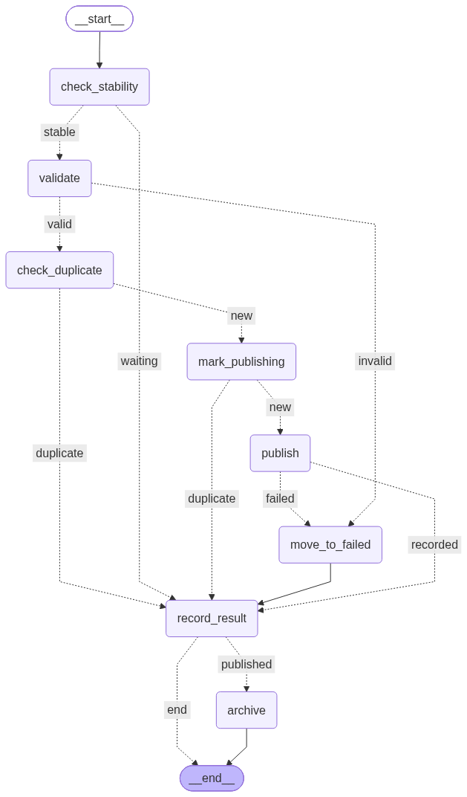

# Social Media Auto-Poster

A local, folder-driven Python application for publishing image + caption posts to social media through official APIs. It publishes to a personal LinkedIn profile today; other platforms are added only after their integrations are separately planned and validated.

The Python application lives in **`backend/`**; its setup, commands, tests, and sandbox tester are summarised in [backend/README.md](backend/README.md). A local FastAPI API (`backend/app/`, started with `python -m app` from `backend/`) and a React dashboard (`frontend/`) are built; see [backend/README.md](backend/README.md#local-api) for how to run them. The API is optional and binds to `127.0.0.1` only.

## MVP goals

- Discover content placed in platform-specific incoming folders.
- Pair image files with UTF-8 caption files and validate them before processing.
- Track post state and processing history so interrupted work can be recovered safely.
- Publish through official platform APIs, archive only confirmed successes, and retain failures with useful diagnostics.
- Prevent duplicate processing and avoid blindly retrying requests whose publishing outcome is ambiguous.

## Non-goals for now

There is no continuous folder watcher, scheduler, or OAuth login flow (the LinkedIn token is created by hand; see "Real mode" below). By default every run is simulated: the simulator does not contact a platform and its result is not confirmation of publication. Real publishing to LinkedIn happens only with `run --real` (or the dashboard's confirmed real run).

## Current status

**Milestones 1 (local simulation), 2 (job database), 3 (crash-safe checkpoints) and 4 (real LinkedIn publishing) are done; Milestone 4 was signed off on 2026-11-17 (`docs/milestone-4-review.md`, D45). The first real post was published on 2026-10-28. A local API and a React dashboard are built.** What exists today:

- Packaging (`backend/pyproject.toml`) with declared dependencies.
- An environment-variable template (`backend/.env.example`).
- Shared models (`models.py`): `Platform`, `JobStatus` (including the terminal `SIMULATED` status), `PostCandidate`, `ScanResult`, `ValidationResult`, and `PublishResult`, which records a definite success or failure and always whether the result was simulated.
- Settings (`config.py`): uses `backend/` as the base folder whatever folder a command is started from, resolves the content folder root, and can create the `data/<Platform>/{incoming,archive,failed}` folders.
- A platform-neutral publisher protocol (`platforms/base.py`).
- A safe simulation publisher that never contacts any platform (`platforms/simulator.py`).
- A LinkedIn publisher (`platforms/linkedin/`) using LinkedIn's official Images and Posts APIs: caption escaping and the 3,000-character limit, image size read from the file header, a token check before every real run, and no automatic retry of a post whose outcome is uncertain.
- Ingestion (`ingestion/`): a one-shot scan that pairs images with captions (`scanner.py`), a file-copy stability check (`stability.py`), content validation (`validation.py`), and adding a post from the dashboard (`intake.py`).
- A service that moves a post's two files together into `archive/` or `failed/` (`services/archive.py`).
- A LangGraph workflow (`graph/`) that takes one post through stability → validation → duplicate check → publish (simulated or real) → record, archiving only confirmed real posts and moving invalid or failed posts to `failed/` with an `error-report.txt`. Simulated posts stay in `incoming/`.
- A job database (`backend\database\app.db`, SQLite, via `storage/`): every processed post is recorded with SHA-256 hashes of its image and caption, so the same content is never processed twice.
- Crash recovery: at the start of every `run`, jobs left half-published by a crash are resolved (see `RECOVERED` below).
- Graph checkpoints (`backend\database\langgraph_checkpoints.db`, a separate SQLite file): each step of a job is saved before the next one starts, so a run that crashed **after** publishing is finished by the next run instead of being marked `NEEDS_REVIEW` (see `RESUMED` below). A crash during the publish itself is never retried.
- Five commands (`main.py`): `run` processes every complete post once (simulated, or real with `--real`), the read-only `scan` (with duplicate check) and `jobs` (history), `resolve` for jobs that need review, and `linkedin-check` for the LinkedIn token and setup. See "How to use" below.
- A local API (`backend/app/`, FastAPI) and a React dashboard (`frontend/`) that call the same functions as the commands. Both are optional.
- Unit, integration and API tests under `backend/tests/`. Decisions are recorded in `docs/decisions.md`.

Platform order:

1. LinkedIn — implemented (personal profile, one image + caption per post).
2. Facebook — planned, not implemented.
3. Instagram — planned, not implemented.

Facebook and Instagram are placeholders for future work, not supported integrations.

## Project roles

- **Ehsan Ullah: project lead.** Architecture and milestone plan; the safety rules (duplicate prevention, `NEEDS_REVIEW`, crash recovery); the LangGraph workflow; the SQLite job database; checkpointing; real LinkedIn publishing; the CLI, the sandbox tester and the test suite (more than 500 tests); code review and integration of all parts, including the local API.
- **Mouzan Raza: initial FastAPI prototype and React dashboard.** Wrote the first FastAPI routers (`scan`, `run`, `jobs`) and the dashboard in `frontend/`. Ehsan adapted both to the current backend: the API calls the same functions as the CLI, and the upload, resolve, LinkedIn status and health endpoints were added. See `docs/decisions.md` (D42 and D43).

## Project layout

Packages marked "empty" contain only an `__init__.py`:

```text
backend/                           The Python project
  pyproject.toml, README.md, .env.example
  src/social_media_auto_poster/
    config.py                      Settings (base folder = backend/) and data-folder creation
    models.py                      Platform, JobStatus, PostCandidate, ScanResult, ValidationResult, PublishResult, PostContent
    platforms/                     Publisher protocol (base.py) and simulator (simulator.py)
    platforms/linkedin/            caption.py, image_size.py, client.py, publisher.py, credentials.py, check.py
    platforms/{facebook,instagram}/   Empty
    graph/                         LangGraph workflow: state.py, nodes.py, workflow.py, checkpoints.py, resume.py
    ingestion/                     Scanning/pairing, stability check, validation, adding a post (intake.py)
    services/                      Hashing, reading post content, moving posts, crash recovery, real-mode checks, single-run lock
    storage/                       SQLite job database and repository
    main.py                        Commands: run, scan, jobs, resolve, linkedin-check
  app/                             Local API (FastAPI; optional "api" extra): main.py, routers/, services/, models/
  tests/unit/, tests/integration/, tests/api/   Unit tests; full-graph and end-to-end run tests; API tests
  scripts/app.py                   Interactive sandbox tester
  data/                            Local platform content; ignored by Git
    LinkedIn/{incoming,archive,failed}/   (and Facebook/, Instagram/)
  database/, logs/, sandbox/       Job database and checkpoints, run log, tester sandbox; ignored by Git
frontend/                          React dashboard (Vite, TypeScript)
docs/decisions.md                  Decision records
docs/api-plan.md                   Local API plan and endpoints
docs/linkedin-api-notes.md         What LinkedIn's official docs say, with sources
docs/milestone-4-review.md         Milestone 4 review and known limitations
```

The binding layout is in `CLAUDE.md` ("Code layout").

## Content naming convention

The initial convention is one image and one UTF-8 text caption with the same filename stem, for example:

```text
backend/data/LinkedIn/incoming/product-launch.jpg
backend/data/LinkedIn/incoming/product-launch.txt
```

The planned initial image extensions are `.jpg`, `.jpeg`, and `.png`. Pairing, the file-copy stability check, and validation (extension, image signature, UTF-8 non-empty caption) exist; see `CLAUDE.md`, "Input conventions". This convention is provisional; media support will be reviewed against each platform's official API before implementation.

## Windows setup

Use Python 3.12 or newer; the project is developed on **Python 3.14**. The virtual environment `.vevn` stays at the repo root; the package is installed from `backend\`:

```powershell
py -3.14 -m venv .vevn               # once, from the repo root
.\.vevn\Scripts\Activate.ps1         # from the repo root
cd backend
python -m pip install --upgrade pip
python -m pip install -e ".[dev]"
```

Dependencies are declared only in `backend\pyproject.toml`. The `[dev]` extra adds `pytest`. Install in editable mode (`-e`): the application keeps its data, database, logs, and `.env` in `backend\`, whichever folder you run a command from.

Verify the environment:

```powershell
python --version
python -m pip check
python -m pytest
```

## How to use (simulated runs)

1. Put an image and a caption with the same name in `backend\data\LinkedIn\incoming\`, e.g. `product-launch.jpg` + `product-launch.txt` (UTF-8 text; `.jpg`, `.jpeg`, or `.png`).
2. Optional preview, changes nothing: `python -m social_media_auto_poster.main scan`
3. Process: `python -m social_media_auto_poster.main run`

Example `run` output:

```text
Processing LinkedIn incoming: D:\social-media-auto-poster\backend\data\LinkedIn\incoming

JOBS (3)
  animated         FAILED                      moved to LinkedIn\failed\20261025T153102Z_animated
                     - unsupported image type '.gif' (allowed: .jpg, .jpeg, .png)
  product-launch   SIMULATED (not published)   files stay in incoming/
  team             SIMULATED (not published)   files stay in incoming/

PENDING (1) - waiting for a partner file
  lonely.jpg

Simulation mode: nothing was sent to LinkedIn in this run.
```

What happens to each post:

| Result | Meaning | Files |
| --- | --- | --- |
| `SIMULATED (not published)` | Valid; publishing was simulated. **Nothing is sent to LinkedIn unless you use `--real`.** | Stay in `incoming/`; recorded in the job database |
| `DUPLICATE` | Same image and caption content as an earlier job (even under a different file name) | Untouched; reported on every run until you delete them |
| `FAILED` | Invalid (or a definite publish failure) | Moved to `failed\<UTC time>_<name>\` with `error-report.txt` explaining why |
| `NEEDS_REVIEW` | Publish outcome unknown (cannot happen with the simulator) | Moved to `failed\...`; check LinkedIn before re-posting |
| `RESUMED` | Shown first when an earlier run crashed after a publish had returned (while recording the result or moving the files). The job is finished from its saved checkpoint; nothing is published again | Moved or kept as for any finished job; a half-finished move is completed |
| `RECOVERED` | Shown before the jobs when an earlier run crashed mid-publish. A simulated job becomes `FAILED` (nothing was sent) and is processed again in the same run; a real one becomes `NEEDS_REVIEW` and is never retried | Simulated: stay in `incoming/`. Real: moved to `failed\...` with a report, if unchanged |
| `WAITING (still copying)` | A file is still being written | Untouched; retried next run |
| `PENDING` / `AMBIGUOUS` | No partner file yet / more than one file per name | Untouched |

Every folder in `failed\` and `archive\` contains a small `.autoposter-job` file with the job ID; it lets an interrupted move be finished safely. To retry a failed post: fix it, move its image and caption back to `incoming\`, and delete the old `failed\` folder. A failed job never blocks a retry; editing the caption (or image) of any post makes it a new job.

`run` options: `--verbose` shows INFO logs in the terminal; `--interval 0` skips the 1-second change-watch wait. The full log is `backend\logs\autoposter.log` (UTC timestamps, rotated at 1 MB, 5 backups; caption text is never logged). Each line carries the run's `run_id`; every run starts with `Run started` and ends with a `Run finished` line that counts each outcome and gives the exit code and duration. Only one `run` can work at a time.

`run` exit codes (useful with Task Scheduler): `0` all simulated/duplicate/waiting or nothing to do, `1` setup error (including a job database that cannot be opened or crash recovery that cannot complete), `2` invalid command or option, `3` at least one job `FAILED`/`NEEDS_REVIEW`/`ERROR` (or a crashed job recovered as `NEEDS_REVIEW`), `4` another run is in progress.

### Real mode: `run --real`

Real publishing is only ever chosen on the command line with `--real`, or in the dashboard by typing the confirmation phrase `publish to LinkedIn` (the API refuses a real run without it). It **cannot be enabled from `.env`** or any other setting, so a scheduled task can never switch to real posting by accident. Real posts go to your own LinkedIn profile, with the access token from `backend\.env` (see `backend\.env.example`: `LINKEDIN_ACCESS_TOKEN`, and `LINKEDIN_TOKEN_CREATED` for expiry warnings). The token lives **only** in `backend\.env`: it is never logged, and never written to the job database, checkpoints, error reports, or API responses. It lasts 60 days and is not renewed automatically; `linkedin-check` shows when it expires. Check the setup first, without posting anything:

```powershell
python -m social_media_auto_poster.main linkedin-check                 # token, expiry, and who posts would be published as
python -m social_media_auto_poster.main linkedin-check --upload-test   # also uploads a test image (never used in a post)
```

A real run checks the token with LinkedIn before anything else; a missing, expired, or rejected token stops it (exit code 1, nothing published). It warns from 7 days before the token expires. A post whose outcome is uncertain (for example, a timeout after sending) is marked `NEEDS_REVIEW` and never retried: check your LinkedIn profile, then use `resolve`.

Before publishing anything, `run --real` refuses (exit code 1, nothing published) when:

- `incoming\` holds posts that were **only simulated** so far. They are listed; remove the ones you do not want on LinkedIn, or confirm with `run --real --publish-simulated`.
- `archive\` holds published posts but the job database has **no record of any real job** (it may have been replaced or lost). Restore your backup of `backend\database\app.db`; without it, posts could be published twice.

`scan --real` previews this: it checks duplicates against real-mode history and marks the posts `run --real` would refuse.

### `scan` (read-only)

`scan` reports what `run` would pick up and never moves or publishes anything:

```powershell
python -m social_media_auto_poster.main scan                          # data\LinkedIn\incoming (respects AUTOPOSTER_DATA_DIR)
python -m social_media_auto_poster.main scan --dir C:\some\folder     # any folder
python -m social_media_auto_poster.main scan --interval 0             # instant: checks locks, skips the change-watch wait
python -m social_media_auto_poster.main scan --help
```

It lists **candidates** (image + caption pairs, each marked stable or not, valid or `INVALID:` with reasons, and for stable valid posts `new` or `DUPLICATE of job …`), **pending** files waiting for a partner, and **ambiguous** stems that need fixing by hand. If the job database has jobs interrupted by a crash, it notes that the next `run` will recover them. `scan` reads the job database read-only and never creates it. Exit code 0 means the scan completed; 1 means the folder does not exist.

### `resolve` (settle a NEEDS_REVIEW job)

A `NEEDS_REVIEW` job (publish outcome unknown) is never retried automatically. After you have checked LinkedIn:

```powershell
python -m social_media_auto_poster.main resolve 8a61f3 --published urn:li:share:123   # it is live: record the post ID; content stays blocked
python -m social_media_auto_poster.main resolve 8a61f3 --failed                       # it is not live: allow a retry
```

Use at least 6 characters of the job ID (from `jobs`). Only `NEEDS_REVIEW` jobs can be resolved; a simulated job cannot be marked published. A timestamped note is added to the job (see `jobs --id`). Files are never moved: the output tells you where they are and, for `--failed`, how to retry (move them back into `incoming\`). If a `run` is in progress, it refuses (exit 4). Exit codes: `0` resolved, `1` refused (nothing changed), `2` invalid arguments, `4` a run is in progress.

### `jobs` (read-only history)

```powershell
python -m social_media_auto_poster.main jobs                    # 20 most recent jobs, newest first
python -m social_media_auto_poster.main jobs --last 50
python -m social_media_auto_poster.main jobs --status FAILED    # one status only
python -m social_media_auto_poster.main jobs --id 8a61f3de      # every detail of one job (an ID prefix is enough)
```

Shows job ID, time (UTC), post name, mode (`simulated` or `real`), status, and any errors; `--id` adds both SHA-256 hashes, file names, post ID, and where the files went. It never creates or changes the database. Exit code 0 on success; 1 if the database cannot be read or the `--id` prefix matches no job or more than one.

### Scheduling (being built, D46)

Schedule a post that is already in `incoming\` (its name, without the extension) for a date and time in your time zone (`AUTOPOSTER_TIMEZONE` in `backend\.env`, default `Asia/Karachi`):

```powershell
python -m social_media_auto_poster.main schedule launch --at "2026-12-01 09:00"          # simulated schedule
python -m social_media_auto_poster.main schedule launch --at "2026-12-01 09:00" --real   # a real LinkedIn post
python -m social_media_auto_poster.main schedules                                         # active schedules (--all, --status S)
python -m social_media_auto_poster.main unschedule launch                                 # cancel it
```

- The post is checked when you schedule it, as a run would check it: complete, valid (including the 3,000-character caption limit; for `--real`, also LinkedIn's image size limit), and not already published or scheduled. The time must be 5 minutes to 1 year ahead; a time skipped or repeated by a clock change is refused.
- The schedule is tied to the exact files: **do not change them** before the scheduled time, or the schedule becomes `INVALID` and is never published.
- Without `--real` the schedule is simulated. Nothing in `.env` can make it real.
- Every run (`run`, `run --real`, and runs from the dashboard) **skips** a post with an active schedule and lists it under `SCHEDULED`. `unschedule` gives the post back to normal runs (then `run --real` would publish it).
- **Not built yet:** publishing scheduled posts at their time (`run --real --scheduled`, run by Windows Task Scheduler). Until it is, scheduled posts are held in `incoming\` and not published.
- With `--real`, a warning is printed if your LinkedIn token is missing or expires on or before the scheduled day. Scheduling never contacts LinkedIn.
- Exit codes: `schedule` and `unschedule`: `0` done, `1` refused (nothing changed; the message says why), `2` invalid arguments (including a time not written as `YYYY-MM-DD HH:MM`), `4` a run is in progress. `schedules`: `0` listed, `1` the job database could not be read, `2` invalid arguments.

**Job database upgrade.** The first `schedule`, `run`, `resolve` or dashboard run after updating upgrades `backend\database\app.db` to version 2. Before changing it, it saves a copy next to it as `app.db.bak-v1` (or, if that file already exists, `app.db.bak-v1-<UTC time>`; an existing backup is never overwritten) and logs where. `scan`, `jobs` and `schedules` only read the database and never upgrade it (`unschedule` does not either: an older database has nothing to cancel). After the upgrade, older versions of the app refuse the database; to go back, restore the `.bak-v1` copy.

## Manual testing

### Interactive tester: `backend/scripts/app.py`

```powershell
cd backend
python scripts\app.py                                 # sandbox: backend\sandbox (ignored by Git)
python scripts\app.py --sandbox D:\tmp\my-sandbox     # any other folder
```

A terminal menu to add sample posts (valid JPEG/PNG, invalid kinds, lone files, ambiguous), run, scan, look at the folders, see job history (via the `jobs` command), simulate a crash during publish (to watch startup recovery) or right after it (menu 13, to watch a job resumed from its checkpoint), resolve a `NEEDS_REVIEW` job, and reset. Everything happens in a **sandbox** with its own `data\`, `database\app.db`, logs, and run lock; your real data and job database are never touched. It refuses to start if the sandbox is, contains, or is inside your real data, `database\`, or `logs\` folder, and it only uses a folder that is empty or already marked as a sandbox (`.autoposter-sandbox`), so Reset can never delete anything else. Publishing is always simulated; Run and Scan call the real `run` / `scan` commands. Valid sample posts share the same tiny image, so adding the same caption twice demonstrates a `DUPLICATE`.

## Backups

The job database, `backend\database\app.db`, is the only record of what was published and the only protection against posting the same content twice. Back it up regularly, and always before a real run:

```powershell
Copy-Item backend\database\app.db "backend\database\app.db.backup-$(Get-Date -Format yyyyMMdd-HHmm)"
```

Copy it while no `run` is in progress. To restore, make sure no `run` is in progress, then copy the backup back over `backend\database\app.db`. If the database is lost while `archive\` still holds published posts, `run --real` refuses to start until it is restored. The checkpoint store (`langgraph_checkpoints.db`) does not need a backup: it only holds work interrupted by a crash.

## Configuration and security

Copy `backend\.env.example` to `backend\.env` for local configuration; the application reads `.env` only from `backend\`. `.env` is ignored by Git; `.env.example` contains only blank placeholders. Do not commit credentials, access tokens, local databases, content, logs, or the sandbox. There is no OAuth login flow: the LinkedIn access token is created by hand in the LinkedIn Developer Portal and put in `backend\.env` (see "Real mode" above and `docs/linkedin-api-notes.md`). Every integration must use official APIs and comply with their permissions and policies.

`AUTOPOSTER_DATA_DIR` moves the content folder (default `backend\data`). If it points outside `backend\`, `scan` and `run` print a warning with the folder they use, and `run --real` refuses to start if that folder does not already have its `LinkedIn\incoming`, `archive`, and `failed` folders (a real run never creates them; run once without `--real` on a new setup). `database\`, `logs\`, and the run lock always stay in the base folder, `backend\`.

Job records live in `backend\database\app.db` (SQLite, created by `run`; ignored by Git). Graph checkpoints live in a separate file, `backend\database\langgraph_checkpoints.db`; it only ever holds jobs that were interrupted, and never caption text. A publishing request with an unknown outcome must not be retried automatically without a platform-safe way to establish whether it succeeded. Content should be archived only after success is confirmed.

## Workflow diagram

Each paired post runs through one LangGraph graph (`backend/src/social_media_auto_poster/graph/workflow.py`). Edge labels show the routing decision at each step.



To regenerate the image after changing the graph (run from `backend\`):

```powershell
python -c "from social_media_auto_poster.graph.workflow import build_workflow; open('../docs/langgraph_workflow.png', 'wb').write(build_workflow().get_graph().draw_mermaid_png())"
```

`draw_mermaid_png()` renders the diagram through the Mermaid.ink web service, so it needs internet access.

## Architecture decisions

- **LangGraph is required** for orchestrating each post's workflow as an explicit, deterministic state graph. It does not use LLMs or autonomous agents; filesystem, validation, database, and API work live in ordinary Python modules that the graph's nodes call.
- **SQLite first.** The application database (business records) and the LangGraph checkpoint store are kept logically separate and introduced in separate milestones. PostgreSQL is deferred until there is a concrete need.
- **Local API and dashboard.** A FastAPI API (`backend/app/`) and a React dashboard (`frontend/`) are built. The API calls the same functions as the CLI (`scan_preview`, `run_once`, `resolve_job`, `linkedin_status`, `add_post`) with no second storage layer, binds to `127.0.0.1`, shares the CLI's run lock, and follows the same real-LinkedIn safety rules; a real run needs `"real": true` and the confirmation phrase (decisions D42 and D43). Start it from `backend\` with `python -m app`; see [backend/README.md](backend/README.md#local-api).

See `CLAUDE.md` for the binding project rules.

## Development milestones

0. Inspect the scaffold, plan, and establish `CLAUDE.md` (done).
1. Local simulation: typed LangGraph state, initial deterministic graph, pairing and validation, simulated publishing, tests (done).
2. Durable application records: SQLite repository, job states, hashes, duplicate detection, restart reconciliation (done).
3. Persistent LangGraph execution: SQLite checkpointer, resume and interruption tests (done).
4. Real LinkedIn publishing through official APIs, with safeguards for ambiguous outcomes (done; first real post 2026-10-28; signed off 2026-11-17).
5. Reliability, operational docs, PostgreSQL evaluation, and Facebook/Instagram planning (next).

The local API and the React dashboard were added alongside Milestone 4 (D42, D43). No feature (for example an OAuth login flow or a folder watcher) should be considered available until it is implemented and covered by appropriate tests.
